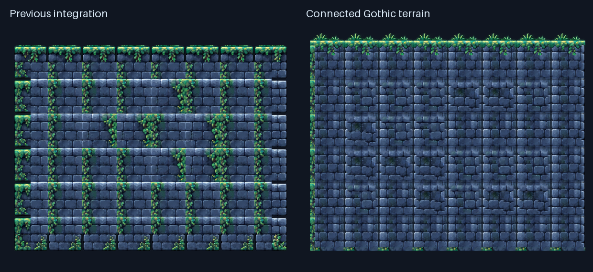

# Gothic terrain review — 14 October 2026

Implemented on **gothic-terrain-production**. The main tower, player settings, original source PNGs and existing region resources are unchanged.

[Painting, slopes and rebuild instructions](../../Art/Dungeon/Terrain/README.md) · [Source inventory](../../Art/Dungeon/Terrain/INVENTORY.md) · [Playable test scene](../../Scenes/TerrainTest/GothicTerrainTest.tscn)

## Visual evidence

All images below were rendered by Godot 4.8 dev6 and visually inspected. Before/after walls use identical cell occupancy, world dimensions and camera framing. The comparison is a lossless crop of those captures.

- [Original repeated borders](review/00_previous_borders.png)
- [New 8×6 continuous wall](review/01_large_wall.png)
- [Irregular wall and enclosed hole](review/02_irregular_hole.png)
- [Moss environment and decorations](review/03_moss_environment.png)
- [Snow environment and decorations](review/04_snow_environment.png)
- [Connected gentle and 45° slopes](review/05_slopes.png)
- [Deliberate moss/ice boundary with bare transition](review/06_mixed_materials.png)
- [Actual Moonward player on the test route](review/07_player_route.png)
- [Complete test environment](review/08_overview.png)

Regenerate raw captures with `GODOT_BIN=/path/to/Godot bash Tests/capture_gothic_review.sh`. Logs and raw development captures stay in ignored output/. These are screenshots, not manually recorded gameplay clips.

## Verification

- **4.8 dev6: 2,420 checks passed**, including the previous 622 gameplay/tower/art checks and 1,798 new Gothic checks; import and main startup passed.
- **4.6 stable: 1,798 Gothic checks passed**, with fresh import of an isolated checkout using the checked-in Godot 4.5 project configuration.
- New tests exercise all 256 neighborhood patterns for each material, native erase/hole corner updates, collision bounds, identical moss/ice geometry, physical slope normals, cell-boundary joins, and actual controller movement in both directions.
- The player jumps onto a floating ledge and performs four alternating wall jumps; the shaft trace rises from about y=1649 to y=1205. Movement parameters are unchanged.
- Python validation checks fixed atlas dimensions, non-overlap, transparent padding, opaque interiors, periodic fill boundaries and source hash. PNG/JSON and native resource rebuilds were byte-identical.
- No script parse failures, missing textures, broken scene references or import failures were observed.
- Existing headless tests and the new suite emit macOS certificate-access and resource/ObjectDB teardown diagnostics. They are retained in the logs; passing checks do not imply those engine diagnostics have been eliminated.

**Limits:** Godot 4.5 is not installed and has not been run. Native painting was tested through Godot's terrain API; manual editor mouse painting and a full human route playthrough remain untested. No full human tower completion is claimed. Gentle slopes are reconstructed from original masonry and diagonal edge pixels. Automatic mixed-material blends and a complete curved collision kit remain unsupported.

## Recommended next task

Migrate **one small, safe opening section** of the tower on a separate branch. First decide how the 72-pixel native art should map to the existing 32-pixel world grid, then compare geometry, camera framing and collision against the original. Validate that section with a human editor-painting and gameplay pass before expanding the migration. Keep interactive shrines, lanterns, platforms and hazards as their existing scenes.
