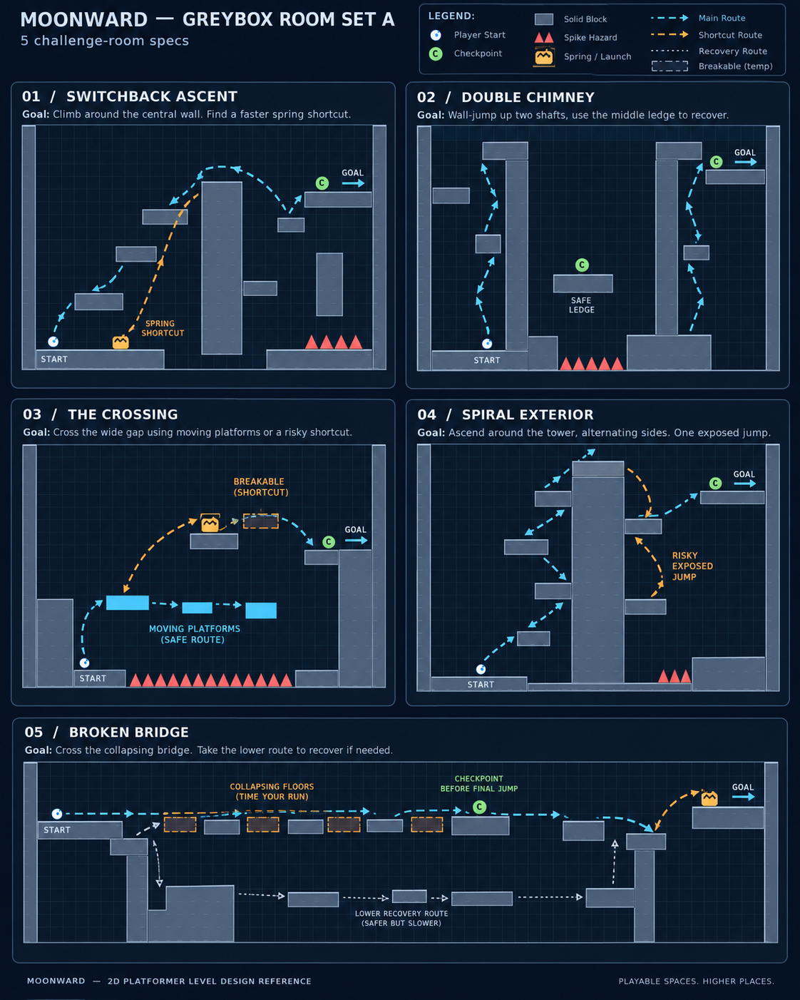

# Moonward level-design reference boards

30 conceptual challenge-room layouts across six five-room sheets, plus first-room detailed sketches and a whole-tower pacing poster. Geometry is illustrative; adjust it to tuned movement physics.

The [main tower](../../World/Tower/README.md) now integrates selected concepts into the original course. The earlier 30-room assembly remains an experimental prototype; its repetitive layout was rejected in play feedback. The boards remain a design library, rather than a requirement to stack every sketch.

- [Rooms 01–05](greybox/rooms-01-05.png)
- [Rooms 06–10](greybox/rooms-06-10.png)
- [Rooms 11–15](greybox/rooms-11-15.png)
- [Rooms 16–20](greybox/rooms-16-20.png)
- [Rooms 21–25](greybox/rooms-21-25.png)
- [Rooms 26–30](greybox/rooms-26-30.png)

- [Tower progression](overview/tower-progression.png)
- [Detailed rooms 01–03](greybox/rooms-01-03-detailed.png)
- [Switchback close-up](greybox/examples/01-switchback.png)
- [Double chimney close-up](greybox/examples/02-double-chimney.png)
- [Crossing close-up](greybox/examples/03-crossing.png)
- [Room catalog](ROOM_CATALOG.md)

